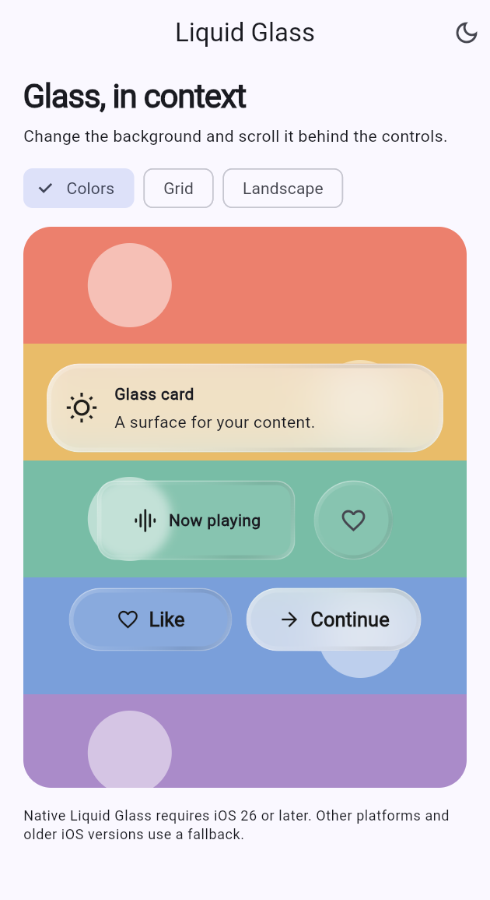
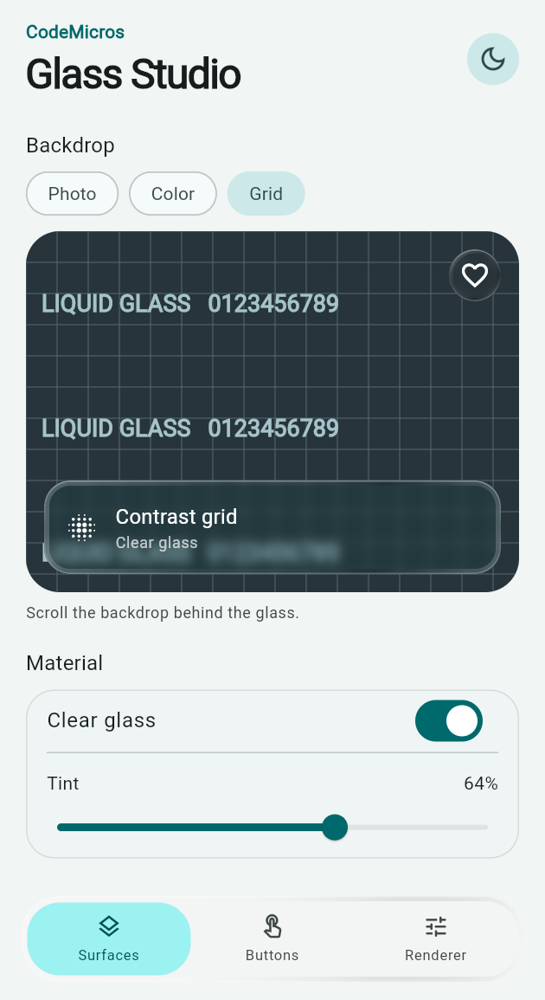

# iOS Liquid Glass Effect

`ios_liquid_glass_effect` by CodeMicros brings Apple’s Liquid Glass surfaces and
buttons to Flutter apps on iOS 26 and later. Older iOS versions use UIKit
materials, and Android, web, and desktop use a Flutter fallback.

## Glass Studio demo

Try glass over a photo, color bands, or a contrast grid. Switch between light
and dark, adjust the tint, and use the floating navigation to try button
states or check the renderer.




The captures show the Flutter web fallback. See the [animated demo and runnable example](https://pub.dev/packages/ios_liquid_glass_effect/example).

## Features

- Place a regular or clear glass material behind any Flutter widget with
  `GlassSurface`.
- Add a native UIKit button with `GlassButton`, including a title, optional SF
  Symbol, disabled state, and a Dart press callback.
- Tune the glass with a tint, rounded corners, or the prominent button style.
- Read native availability and iOS accessibility settings with
  `LiquidGlass.getCapabilities()`.
- Preview the Flutter fallback on iOS with `forceFallback: true`.

## Requirements

- Flutter 3.41 or later and Dart 3.11 or later.
- Xcode 26 or later with the iOS 26 SDK or newer for iOS builds.
- An iPhone or iPad running iOS 26 or later for native Liquid Glass.

| Runtime | Surface | Button |
| --- | --- | --- |
| iOS 26+ | UIKit Liquid Glass | UIKit glass or prominent glass |
| Earlier supported iOS versions | UIKit blur or solid material | Conventional UIKit button |
| Android, web, macOS, Windows, and Linux | Flutter glass effect | Flutter button with a glass effect |

The plugin declares an iOS 13 deployment target. The Flutter SDK and other
app dependencies may require a higher minimum. This release is an alpha.
Static analysis, widget tests, and an iOS simulator build have passed.
Physical-device appearance and interaction still need validation.

## Installation

For pub.dev installs, add the alpha release to your Flutter app.

```sh
flutter pub add 'ios_liquid_glass_effect:^0.1.0-alpha.2'
```

To use a local checkout, set the dependency path relative to your app’s
`pubspec.yaml`, then run `flutter pub get`.

```yaml
dependencies:
  ios_liquid_glass_effect:
    path: ../ios_liquid_glass_effect
```

Rebuild the iOS app after adding the dependency so Flutter registers the plugin.

## Quick start

Place a `GlassSurface` over an image, gradient, or scrolling content so there
is a visible backdrop for the glass to sample.

```dart
import 'package:flutter/material.dart';
import 'package:ios_liquid_glass_effect/ios_liquid_glass_effect.dart';

Widget buildGlassCard() {
  return const Stack(
    alignment: Alignment.center,
    children: [
      SizedBox(
        width: 320,
        height: 180,
        child: DecoratedBox(
          decoration: BoxDecoration(
            gradient: LinearGradient(colors: [Colors.indigo, Colors.teal]),
          ),
        ),
      ),
      GlassSurface(
        style: GlassStyle.regular,
        cornerRadius: 24,
        padding: EdgeInsets.symmetric(horizontal: 24, vertical: 16),
        child: Text('Now playing'),
      ),
    ],
  );
}
```

Use `GlassStyle.clear` for more transparency and `tintColor` to add a tint.
`GlassSurface` keeps its child in Flutter, so your Flutter widgets own their
layout, gestures, and semantics.

## Glass button

`GlassButton` uses UIKit for the button’s title, symbol, interaction, and
accessibility on iOS. Set `fallbackIcon` separately for Flutter platforms.

```dart
Widget buildContinueButton(VoidCallback onContinue) {
  return GlassButton(
    label: 'Continue',
    systemImage: 'arrow.right',
    fallbackIcon: Icons.arrow_forward,
    prominent: true,
    width: 180,
    height: 54,
    onPressed: onContinue,
  );
}
```

Pass `onPressed: null` to disable the button. Use `accessibilityLabel` when the
visible title needs more context for a screen reader. `height` sets a minimum
and can grow with the app’s text scaling.

## Check native availability

```dart
Future<void> logGlassCapabilities() async {
  final capabilities = await LiquidGlass.getCapabilities();
  debugPrint('Native glass available: ${capabilities.nativeGlassAvailable}');
  debugPrint('Reduce Transparency: ${capabilities.reduceTransparency}');
}
```

The result is a snapshot. Query it again if your app displays these settings
and the user returns from system Settings. The Flutter fallback uses a solid
material in high-contrast mode. Where the Flutter renderer supports shader
filters, the fallback adds edge refraction.

## Run the example

The [example app](example/lib/main.dart) is an interactive gallery of surfaces,
buttons, and renderer settings.

If your checkout has no `example/ios/` runner, create it from the package root
with `bash tool/bootstrap_example.sh ios`. The script also accepts `android`
and `web`.

```sh
cd example
flutter pub get
flutter devices
flutter run
```

## Layout tips

- Give glass controls bounded space. `GlassSurface` sizes around its child, and
  `GlassButton` uses an explicit width and minimum height.
- Test text and icon contrast against the actual backdrop, especially with
  `GlassStyle.clear`.
- Let UIKit shape the native glass. Additional Flutter clips, opacity, color
  filters, or backdrop filters around native views can affect composition.
- Let UIKit handle native button presses. Verify gestures and accessibility
  inside the host app’s scroll views and route transitions.

See the [architecture guide](doc/ARCHITECTURE.md) for renderer behavior and the
[validation guide](doc/VALIDATION.md) for build and device checks.

## Support

For support, include your Flutter version, OS version, and a short example
that reproduces the behavior. [Report an issue on GitHub](https://github.com/amityamsi/ios_liquid_glass_effect/issues) or [contact CodeMicros](mailto:codemicros@gmail.com).

[CodeMicros website](https://www.codemicros.com/) · [CodeMicros on pub.dev](https://pub.dev/publishers/codemicros.com/packages)

## License

Copyright © 2026 CodeMicros. All rights reserved except as granted under the
[MIT License](LICENSE).
