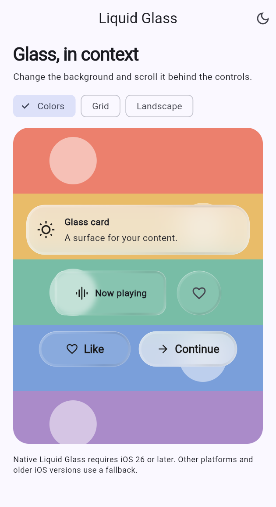
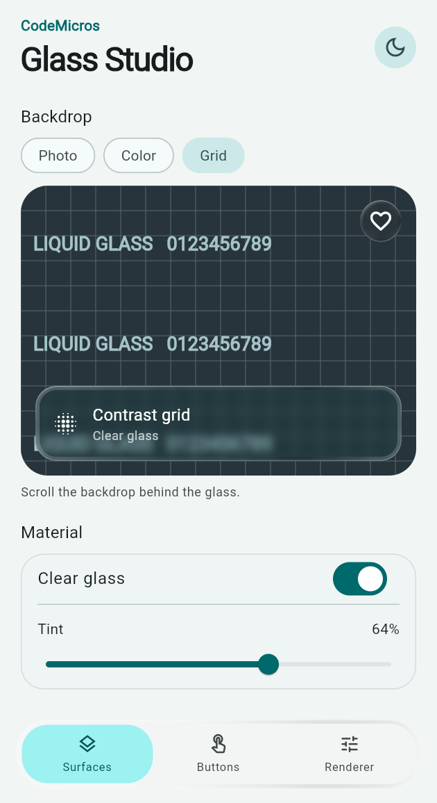
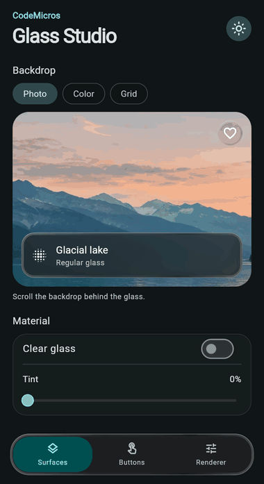

# Glass Studio

The example app puts `GlassSurface` and `GlassButton` into a small interactive
gallery. The floating navigation opens the surfaces, buttons, and renderer
panels.




- **Surfaces** lets you scroll three backdrops, compare regular and clear glass,
  and adjust the tint.
- **Buttons** shows the normal, prominent, and disabled states. Tap **Like** to
  update its label or **Continue** to open a sheet.
- **Renderer** shows the selected renderer and lets you force the Flutter
  fallback on iOS.



These captures show the Flutter web fallback. Run the app on iOS 26 or later
for native UIKit Liquid Glass.

## Run Glass Studio

The gallery starts in `example/lib/main.dart`. If your copy has no platform
runner, run `bash tool/bootstrap_example.sh ios` or
`bash tool/bootstrap_example.sh web` from the package root first.

```sh
cd example
flutter pub get
flutter run
```

## Minimal example

Add `ios_liquid_glass_effect` to a Flutter app and put this in `lib/main.dart`
to try a surface and button together.

```dart
import 'package:flutter/material.dart';
import 'package:ios_liquid_glass_effect/ios_liquid_glass_effect.dart';

void main() => runApp(const MaterialApp(home: GlassDemo()));

class GlassDemo extends StatelessWidget {
  const GlassDemo({super.key});

  @override
  Widget build(BuildContext context) {
    return Scaffold(
      body: Center(
        child: SizedBox(
          width: 280,
          height: 220,
          child: ColoredBox(
            color: const Color(0xff428582),
            child: Center(
              child: Column(
                mainAxisSize: MainAxisSize.min,
                children: [
                  const GlassSurface(child: Text('Liquid Glass')),
                  const SizedBox(height: 12),
                  GlassButton(
                    label: 'Continue',
                    systemImage: 'arrow.right',
                    fallbackIcon: Icons.arrow_forward,
                    prominent: true,
                    onPressed: () => ScaffoldMessenger.of(context).showSnackBar(
                      const SnackBar(content: Text('Glass button pressed')),
                    ),
                  ),
                ],
              ),
            ),
          ),
        ),
      ),
    );
  }
}
```
